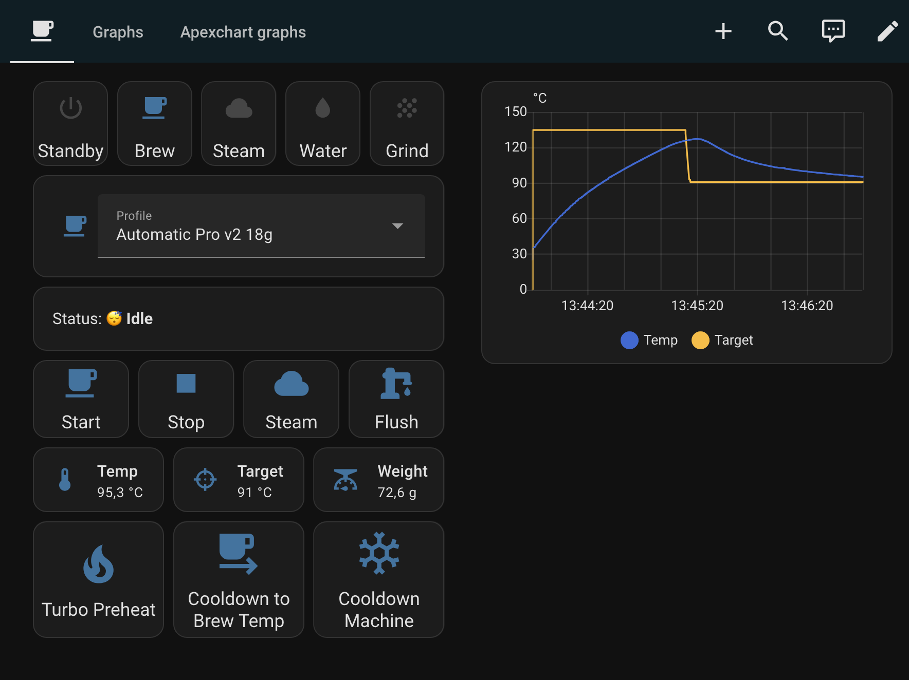

# GaggiMate Home Assistant Integration

[](https://github.com/hacs/integration)
[](https://github.com/GaggiMate/ha-integration/releases)

Control and monitor your GaggiMate-equipped espresso machine directly from Home Assistant. This custom integration provides comprehensive control over your machine's temperature, brewing modes, profiles, and more through native Home Assistant entities.

## Table of Contents

- [Features](#features)
- [Supported Entities](#supported-entities)
- [Installation](#installation)
- [Configuration](#configuration)
- [Services](#services)
- [Automation Examples](#automation-examples)
- [Example Dashboard](#example-dashboard)
- [Troubleshooting](#troubleshooting)
- [Development / Running Tests](#development--running-tests)
- [Support](#support)
- [Contributing](#contributing)

## Features

- 🌡️ **Real-time Temperature Monitoring** - Track current and target temperatures
- ☕ **Mode Control** - Switch between Standby, Brew, Steam, Hot Water, and Grind modes
- 🎮 **Full Machine Control** - Start/stop brewing and flush cycles; switch modes for steam, water, or grind
- 📊 **Profile Selection** - Select brewing profiles
- ⚖️ **Scale Integration** - Monitor weight from connected BLE scales
- 🔄 **Firmware Updates** - Track firmware versions and available updates
- 🏠 **Native HA Integration** - Uses standard Home Assistant entity types for seamless automation
- 🧹 **Shot History Maintenance** - Built-in service to trim stored shots and keep only the newest entries

## Supported Entities

### Sensors
| Entity | Description | Device Class |
|--------|-------------|--------------|
| Current Temperature | Live temperature reading from the machine | Temperature |
| Target Temperature | Desired temperature target | Temperature |
| Current Pressure | Live pressure reading from the machine | Pressure |
| Target Pressure | Desired pressure target | Pressure |
| Pump Flow | Current pump flow rate | - |
| Heater Power | Heater duty cycle in % (0 in standby) | - |
| Pump Power | Pump power in % | - |
| Puck Resistance | Puck resistance in s*sqrt(bar)/mL; unknown outside 0-100 and unless the machine reports pressure and dimming (disabled by default) | - |
| Puck Flow | Flow through the puck in mL/s; only on machines with pressure and dimming | - |
| Target Flow | Target flow in mL/s during a process; unknown when 0 (disabled by default); only on machines with dimming | - |
| Water Pumped | Water pumped during the current or last process in mL; appears after the first brew or process (the machine only reports it during/after a process); keeps its last value; only on machines with pressure and dimming | - |
| Steam Temperature | Steam boiler temperature (dual-boiler machines only) | Temperature |
| Target Steam Temperature | Steam boiler temperature target (dual-boiler machines only) | Temperature |
| Mode | Active machine mode (Standby, Brew, Steam, Hot Water, Grind); dual-boiler machines report Brew for Steam/Hot Water | - |
| Status | Derived machine status (Idle, Brewing, Steaming, Grinding, Pouring Water) | - |
| Process Phase | Current process phase label from the machine (e.g. infusion, brew, finished) | - |
| Selected Profile | Currently active brewing profile | - |
| Target Shot Weight | Target shot volume for the selected profile | Weight |
| Shot Weight Progress | Current shot volume progress during extraction | Weight |
| Scale Connection | BLE scale connection state (Connected/Disconnected) | - |
| Current Weight | Live weight of the active scale source (BLE or hardware scale, or flow estimate); unknown when no source is active. Attribute `source` shows which one | Weight |
| Hardware Model | Controller hardware model information (diagnostic) | - |
| Display Firmware Version | Current display firmware version (diagnostic) | - |
| Controller Firmware Version | Current controller firmware version (diagnostic) | - |
| Display Update Available | Display firmware update status (diagnostic) | - |
| Controller Update Available | Controller firmware update status (diagnostic) | - |
| Latest Software Version | Latest available firmware version (diagnostic) | - |
| System State | Controller state: starting, waiting, ready, updating, autotuning, mismatch, error; attributes `message` and `error_code`. Created when the firmware reports `sys` | Enum |
| Controller Link | Link to the controller: ble, uart or none (diagnostic) | Enum |
| Controller Link RSSI | BLE signal strength in dBm; unknown unless the link is BLE (diagnostic, disabled by default) | Signal strength |
| Controller Link Latency | BLE round-trip latency in ms; unknown until measured (diagnostic, disabled by default) | Duration |
| Controller Link Retransmits | Communication frames resent since boot (diagnostic, disabled by default) | - |
| Scale Battery | Battery level of the connected BLE scale in %; unknown when no scale or level unknown (diagnostic) | Battery |
| Active Scale Source | Source of the weight reading: hardware, bluetooth, estimation or inactive (diagnostic) | Enum |
| Backflush Due | Backflush warning state (Active/Inactive) with severity; only created when the firmware reports the warning (diagnostic) | - |
| Descaling Due | Descaling warning state (Active/Inactive) with severity; only created when the firmware reports the warning (diagnostic) | - |

A change of the machine's update flag triggers a refresh of the OTA settings, so the Display/Controller Update Available sensors do not go stale.

Entities that depend on a firmware key or capability are created once the machine reports it, which can be a few seconds after Home Assistant starts. The controller-link RSSI, latency and retransmit sensors are disabled by default; enable them in the entity settings.

### Binary Sensors
| Entity | Description | Device Class |
|--------|-------------|--------------|
| Controller Error | On when the controller reports an error code or an error/mismatch state (diagnostic) | Problem |
| Update Available | On when a display or controller firmware update is available (diagnostic) | Update |
| Brew Confirmation Pending | On while the machine waits for a brew start to be confirmed (see [Brew confirmation](#brew-confirmation)); attribute `warnings` lists the blocking warnings as `key`, `severity`, `severity_level` | - |
| Tank Level Low | On when the tank sensor reports the tank as not OK; unknown without a reading. Only created where the machine reports a tank sensor: a tank switch, or a ToF tank sensor on dual-boiler machines (e.g. Alba) | Problem |
| Steam Boiler Low | On when the steam boiler level sensor reports low water. Only created on dual-boiler machines with the steam level sensor enabled, once it reports a reading | Problem |

**Tank and water level entities:** the Tank level sensor (%) is the level estimate. The Water Tank Low sensor (diagnostic) is the firmware warning: active whenever a ToF sensor reports below 20 %, with the warning's severity as an attribute; the severity setting decides whether an active warning asks for confirmation before brewing. Tank Level Low is the raw state of the tank sensor and is unknown without a reading. A tank switch alone produces no Water Tank Low warning, so Tank Level Low is the entity to use for it. Tank Level Low and Water Tank Low can only be compared where both exist. Steam Boiler Low is the raw steam level state and has no warning counterpart.

### Brew confirmation

A warning whose severity is set to *Error* on the machine does not block brewing outright: when you press **Start Brew** (or start from the display or web UI) in brew mode, the machine does not brew but asks for confirmation. Start Brew can therefore appear to do nothing while such a warning is active. Home Assistant shows the request as **Brew Confirmation Pending** (on, with the blocking warnings in the `warnings` attribute). Answer it with **Confirm Brew** (starts the brew, ignoring the warnings) or **Cancel Brew Confirmation**; Start Brew itself never overrides the warning.

The pending state clears when the confirmation is cancelled (from any client), when a brew process starts, when the machine mode changes away from Brew, and when the connection to the machine is lost. Confirm Brew starts the brew only if the machine is ready.

Example: notify when a brew is waiting for confirmation:

```yaml
trigger:
  - platform: state
    entity_id: binary_sensor.gaggimate_brew_confirmation_pending
    to: "on"
action:
  - service: notify.mobile_app_phone
    data:
      message: "Brew blocked: {{ state_attr('binary_sensor.gaggimate_brew_confirmation_pending', 'warnings') | map(attribute='key') | join(', ') }}"
```

**Warning:** the confirmation is the machine's safety prompt for an error-level warning (for example an empty water tank). An automation that presses Confirm Brew blindly bypasses it; only automate it when you check the warnings first.

### Controls
| Entity | Type | Description |
|--------|------|-------------|
| Machine Active | Switch | Turn the machine on/off |
| Mode | Select | Choose machine operating mode (dual-boiler machines offer Standby, Brew and Grind only) |
| Profile | Select | Choose brewing profile |
| Target Temperature Setpoint | Number | Set desired temperature (0–160 °C) |
| Start Brew | Button | Begin brewing operation. With an error-level warning active the machine asks for confirmation instead (see [Brew confirmation](#brew-confirmation)) |
| Stop Brew | Button | Stop active process (brew or steam) |
| Flush | Button | Trigger flush cycle |
| Flush Stop | Button | Release a hold-to-flush (no effect during a fixed-length flush) |
| Clear Process | Button | Clear the finished process state on the machine |
| Confirm Brew | Button | Start the brew although an error-level warning is active. Available only while Brew Confirmation Pending is on |
| Cancel Brew Confirmation | Button | Dismiss the pending brew confirmation. Available only while Brew Confirmation Pending is on |
| Tare Scale | Button | Tare the hardware scale. Only created when the machine reports a hardware scale |
| Steam Heater | Switch | Turn the steam boiler on/off. Dual-boiler machines only; turning on in standby is rejected, and turning off when already off is a silent no-op. The firmware only has a toggle, so a command is sent only when the state has to change; a change made at the same moment from the web UI or display can still be reversed |
| Trim Shot History | Service | Remove oldest stored shots, keeping only a specified maximum |

## Installation

### HACS (Recommended)

[](https://my.home-assistant.io/redirect/hacs_repository/?owner=gaggimate&repository=ha-integration&category=integration)

Or add the repository manually:

1. Open HACS in your Home Assistant instance
2. Click on the three dots menu (⋮) in the top right corner
3. Select **Custom repositories**
4. Add this repository URL: `https://github.com/gaggimate/ha-integration`
5. Select **Integration** as the category
6. Click **Add**
7. Search for "GaggiMate" in HACS
8. Click **Install**
9. Restart Home Assistant

### Manual Installation

1. Download the latest release from the [releases page](https://github.com/gaggimate/ha-integration/releases)
2. Extract the `custom_components/gaggimate` folder
3. Copy it to your Home Assistant `custom_components` directory:
   ```
   <config_directory>/custom_components/gaggimate/
   ```
4. Restart Home Assistant

## Configuration

### Adding the Integration

1. Navigate to **Settings** → **Devices & Services**
2. Click **+ Add Integration**
3. Search for "GaggiMate"
4. Enter your GaggiMate machine's details:
   - **Host/IP Address**: The IP address or hostname of your GaggiMate controller
   - **Port**: WebSocket port (default: 80)
5. Click **Submit**

The integration will automatically discover all available entities and create them in Home Assistant.

## Services

### `gaggimate.trim_shot_history`

Deletes the oldest shot logs on each connected GaggiMate so that no more than `max_shots` non-annotated shots remain.
When `keep_annotated: true` is set, shots with notes, ratings, bean type, or grind settings are excluded from trimming entirely; `max_shots` applies only to the remaining non-annotated shots.

**Firmware requirement:** current firmware no longer offers a shot list over the websocket. The service reads the shot index from `http://<host>:<port>/api/history/index.bin` (the same file the web UI uses) and falls back to the old websocket list only if the device answers 404 for it. If the index cannot be read or has an unknown format/version, the service fails with an error and deletes nothing. With `keep_annotated`, every shot is checked individually for notes (one request per shot), because the index flags are not reliable; shots that cannot be checked are kept and reported as an error. Shots are deleted one by one; if any device cannot be read or any deletion fails, the service reports an error after processing all devices.

Example automation:

```yaml
service: gaggimate.trim_shot_history
data:
  max_shots: 5
  keep_annotated: true
```

Daily trim at midnight keeping the 5 newest shots:

```yaml
alias: "GaggiMate: Daily trim shot history"
trigger:
  - platform: time
    at: "00:00:00"
action:
  - service: gaggimate.trim_shot_history
    data:
      max_shots: 5
      keep_annotated: true
```

## Automation Examples

### Basic Automation: Morning Warm-Up

```yaml
alias: "Start Espresso Machine in the Morning"
trigger:
  - platform: time
    at: "07:00:00"
condition:
  - condition: time
    weekday:
      - mon
      - tue
      - wed
      - thu
      - fri
action:
  - service: switch.turn_on
    target:
      entity_id: switch.gaggimate_machine_active
  - service: select.select_option
    target:
      entity_id: select.gaggimate_mode
    data:
      option: "Brew"
```

### Temperature-Based Alert

**Goal:** Remind you that your espresso machine has finished preheating. This automation sends a notification once the boiler temperature has been stable above your target for a set period, so you know it's ready to brew.

```yaml
alias: "Alert When Espresso Ready"
trigger:
  - platform: numeric_state
    entity_id: sensor.gaggimate_current_temperature
    above: 86
    for:
      minutes: 10
condition:
  - condition: state
    entity_id: select.gaggimate_mode
    state: "Brew"
action:
  - service: notify.mobile_app
    data:
      message: "☕ GaggiMate is ready!"
```

### Turbo Preheat: Faster Boiler & Portafilter Warm-Up

Immediately raises the target temperature to 120°C, waits for the boiler to reach the original profile temperature, then holds at the boosted setpoint for an additional 30 seconds before restoring the profile temperature. This pushes extra heat into the boiler and portafilter so everything reaches brewing temperature faster.

```yaml
alias: "GaggiMate Turbo Preheat"
icon: mdi:fire
description: "Bring the boiler and portafilter up to a stable temp faster. Boost setpoint to 120°C until profile temp reached, hold 30s, then restore profile temp"
sequence:
  - service: select.select_option
    target:
      entity_id: select.gaggimate_mode
    data:
      option: "Brew"
  - wait_template: "{{ states('sensor.gaggimate_target_temperature') | float > 60 }}"
    timeout: "00:00:15"
    continue_on_timeout: false
  - variables:
      original_temp: "{{ states('sensor.gaggimate_target_temperature') | float }}"
  - service: number.set_value
    target:
      entity_id: number.gaggimate_target_temperature_setpoint
    data:
      value: 120
  - wait_template: "{{ states('sensor.gaggimate_current_temperature') | float >= original_temp }}"
    timeout: "00:05:00"
    continue_on_timeout: true
  - delay:
      seconds: 30
  - service: number.set_value
    target:
      entity_id: number.gaggimate_target_temperature_setpoint
    data:
      value: "{{ original_temp }}"
mode: single
```

### Cool Down Machine

Switches to Hot Water mode with a 25°C target and dispenses water through the steam wand until the boiler temperature drops below 30°C, then restores the original settings. Make sure to open the steam valve and place a container underneath the wand before running this script.

If the pressure rises above 5 bar for 10 seconds after the initial release (indicating the steam wand has been closed), the script aborts, restores the original temperature, and switches to Standby.

```yaml
alias: "GaggiMate Cool Down Machine"
icon: mdi:snowflake
description: "Cool the machine down by dispensing hot water until temperature is below 30°C. Aborts if steam wand is closed (pressure > 5 bar for 10s)."
sequence:
  - service: select.select_option
    target:
      entity_id: select.gaggimate_mode
    data:
      option: "Hot Water"
  - wait_template: "{{ states('sensor.gaggimate_mode') == 'Hot Water' }}"
    timeout: "00:00:10"
    continue_on_timeout: false
  - variables:
      original_water_temp: "{{ states('sensor.gaggimate_target_temperature') | float }}"
  - service: number.set_value
    target:
      entity_id: number.gaggimate_target_temperature_setpoint
    data:
      value: 25
  - service: button.press
    target:
      entity_id: button.gaggimate_start_brew
  - delay:
      seconds: 5
  - wait_template: >-
      {{ states('sensor.gaggimate_current_temperature') | float < 30 or
         states('sensor.gaggimate_current_pressure') | float > 5 }}
    timeout: "00:02:00"
    continue_on_timeout: true
  - if:
      - condition: numeric_state
        entity_id: sensor.gaggimate_current_pressure
        above: 5
    then:
      - delay:
          seconds: 10
      - if:
          - condition: numeric_state
            entity_id: sensor.gaggimate_current_pressure
            above: 5
        then:
          - service: button.press
            target:
              entity_id: button.gaggimate_stop_brew
          - service: number.set_value
            target:
              entity_id: number.gaggimate_target_temperature_setpoint
            data:
              value: "{{ original_water_temp }}"
          - service: select.select_option
            target:
              entity_id: select.gaggimate_mode
            data:
              option: "Standby"
          - stop: "Aborted: steam wand appears closed (pressure > 5 bar)"
  - service: button.press
    target:
      entity_id: button.gaggimate_stop_brew
  - service: number.set_value
    target:
      entity_id: number.gaggimate_target_temperature_setpoint
    data:
      value: "{{ original_water_temp }}"
  - service: select.select_option
    target:
      entity_id: select.gaggimate_mode
    data:
      option: "Standby"
mode: single
```

### Cooldown to Brew Temp

After steaming, the boiler is well above brew temperature. This script switches to Brew mode, reads the profile's target temperature, and repeatedly triggers flush cycles through the group head until the boiler cools to within 10°C of the brew target. Remove the portafilter and flush to the drip tray or a container.

```yaml
alias: "GaggiMate Cooldown to Brew Temp"
icon: mdi:coffee-to-go
description: "Cool the boiler from steam temp back to brew temp by repeatedly flushing through the group head until brew temperature is reached."
sequence:
  - service: select.select_option
    target:
      entity_id: select.gaggimate_mode
    data:
      option: "Brew"
  - wait_template: "{{ states('sensor.gaggimate_mode') == 'Brew' }}"
    timeout: "00:00:10"
    continue_on_timeout: false
  - wait_template: "{{ states('sensor.gaggimate_target_temperature') | float > 60 }}"
    timeout: "00:00:15"
    continue_on_timeout: false
  - variables:
      target_brew_temp: "{{ states('sensor.gaggimate_target_temperature') | float }}"
  - repeat:
      sequence:
        - service: button.press
          target:
            entity_id: button.gaggimate_flush
        - delay:
            seconds: 3
        - wait_template: "{{ states('sensor.gaggimate_status') == 'Idle' }}"
          timeout: "00:00:30"
          continue_on_timeout: true
      until:
        - condition: template
          value_template: >-
            {{ states('sensor.gaggimate_current_temperature') | float <= target_brew_temp + 10
               or repeat.index >= 10 }}
mode: single
```

## Example Dashboard

An example Home Assistant dashboard is available in the [`examples/dashboard`](examples/dashboard/) folder. The dashboard aims to be a full GaggiMate control panel, allowing you to operate the machine and monitor your shot. See the [dashboard README](examples/dashboard/README.md) for setup instructions.



## Troubleshooting

### Connection Issues

**Problem**: Integration can't connect to the machine
- Verify the IP address/hostname is correct
- Ensure the machine is powered on and connected to your network
- Check that there are no firewall rules blocking the connection
- Verify your Home Assistant instance can reach the machine's network

**Problem**: Integration keeps disconnecting
- Consider setting a static IP for your GaggiMate
- Check for WiFi signal strength issues

### Entity Issues

**Problem**: Entities not updating
- Check the integration logs: Settings → System → Logs
- Try reloading the integration: Settings → Devices & Services → GaggiMate → ⋮ → Reload
- Verify the WebSocket connection is stable

**Problem**: "GaggiMate is not ready" error from Machine Active, Mode or Start Brew
- These commands are rejected until the controller link is up and the machine reports state "ready" (e.g. while it is starting or waiting for the controller)
- Check the System State / controller connection and try again once the machine is ready

**Problem**: Mode select does not offer Steam / Hot Water, or an automation selecting them fails
- On dual-boiler machines the firmware maps Steam and Hot Water to Brew, so the Mode select only offers Standby, Brew and Grind; automations selecting Steam or Hot Water get an invalid-option error

**Problem**: Scale weight not showing
- Ensure your BLE scale is paired with the GaggiMate (not Home Assistant)
- Check the scale connection status sensor

## Development / Running Tests

The test suite uses [pytest-homeassistant-custom-component](https://github.com/MatthewFlamm/pytest-homeassistant-custom-component) (PHACC), pinned in `requirements_test.txt`. PHACC requires **Python 3.14** and does not support native Windows, so run the tests on Linux or WSL. CI runs them on Ubuntu with Python 3.14 (`.github/workflows/tests.yaml`).

**Windows (WSL + uv)**

1. Install WSL with a Linux distribution (from an elevated PowerShell: `wsl --install`, then reboot).
2. Inside the distribution, install [uv](https://docs.astral.sh/uv/getting-started/installation/) and let it provide Python 3.14:
   ```bash
   curl -LsSf https://astral.sh/uv/install.sh | sh
   uv python install 3.14
   ```
3. From the repository (on the WSL filesystem, e.g. under `~`, for speed):
   ```bash
   uv venv --python 3.14 .venv
   source .venv/bin/activate
   uv pip install -r requirements_test.txt
   pytest
   ```

**Linux / macOS**

```bash
uv venv --python 3.14 .venv && source .venv/bin/activate
uv pip install -r requirements_test.txt
pytest
```

The tests run against an in-process fake GaggiMate websocket server and do not contact a real machine. Configuration is in `pytest.ini`.

## Support

- **Documentation**: [GaggiMate Docs](https://docs.gaggimate.eu/)
- **Issues**: [GitHub Issues](https://github.com/gaggimate/ha-integration/issues)
- **Main GaggiMate Project**: [jniebuhr/gaggimate](https://github.com/jniebuhr/gaggimate)
- **Shop**: [shop.gaggimate.eu](https://shop.gaggimate.eu/)

## Contributing

Contributions are welcome! Please feel free to submit a Pull Request. For major changes, please open an issue first to discuss what you would like to change.
